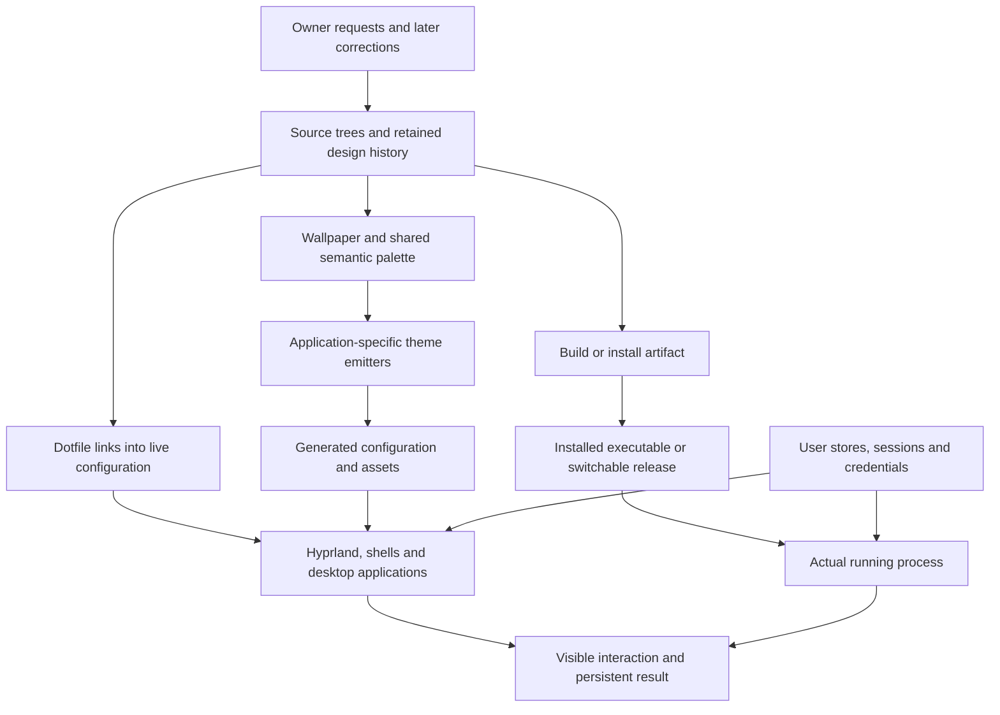

# Architecture and ownership map

This map summarizes verified source/deployment relationships from the ongoing audit. It is a navigation aid; the linked reports retain exact versions, hashes and acceptance limits. The owner requested bounded closeout; see [development handover](closeout.md).

The arrows are separate verification boundaries. Source can be correct while an installed binary is older; a theme can remain selected after its emitter disappears; a running process can retain an older executable after replacement. Source hashes establish identity, and rendered interaction establishes a different claim. Current examples are [Spark's surviving theme](spark-emitter-provenance.md), [SDDM's installed selection](sddm-history.md), [concurrent terminal browser](concurrent-browser.md), and [Sonata's checkout versus serving release](sonata-source.md).

## Desktop and terminal

Hyprland's active Lua startup path controls the compositor, launches the authored session and applies shared material policy. Eww, Waybar and SwayNC are distinct consumers with their own state/IPC and launch lifecycles. Their presence does not require the corresponding user unit to be enabled. Theme generation translates shared semantic colors into each application's contract; geometry and opacity must be interpreted at that consumer, rather than copied blindly between CSS, Lua, GTK, Qt and terminal cells. See [desktop](desktop.md), [machine](machine.md) and [visual configuration](machine-visual-configs.md).

Fish, Starship, tmux, Neovim and the terminal applications form another interaction chain. Shell variables, function scope, terminal ownership, foreground process and pane/client modes affect whether an action reaches its intended consumer. Kitty image identifiers share a terminal namespace; independent clients need explicit ownership. A successful helper invocation does not prove focus, picker behavior, clipboard delivery or compositor interaction. See [desktop boundary review](cross-review-desktop-boundaries.md), [WhatsApp UI](whatsapp-ui.md) and [browser](concurrent-browser.md).

## Agent control and deployment

Sonata's native lane is a machine router with per-request tenant resolution and ranked candidate fallback. The harness lane launches a separate tool in tmux and observes report/sentinel/progress state. A529 suggests dispatch; it does not itself execute another harness. Priced UTC ledger totals drive admission, with unknown/covered/in-flight accounting limits. Daemon health, account availability and successful inference are different facts. Source, token ownership, deployment release and serving process must stay separately identifiable. See [source](sonata-source.md), [operating documents](sonata-operating-docs.md) and [machine helpers](machine-helpers.md).

Installed Nous Hermes, the cloud Hermes coordinator project and Omnigent are separate systems. Pairing policy in memory files is not a replication engine, and stored permission names are not effective enforcement proof. Installed Omnigent has a completed source review; the deeper Nous Hermes expansion ends with explicit unread limits in the development handover. This map does not claim every installed upstream behavior was verified. See [Hermes setup history](hermes-infra.md) and [Omnigent runtime](omnigent-runtime.md).

## Persistence and authority

Source-owned links, generated output, user state, credentials, cached observations and deployment releases have different recovery contracts. cloudsync, reviewed lazyrsync profiles and persistent downloadsync serve different scopes; combining their status does not justify replacing their protocols. Enabled services and configured retry are source evidence, with reconnect/reboot acceptance separate. See [machine helpers](machine-helpers.md).

Effective OS authority is broad: current sudo policy grants the owner passwordless ALL, independently confirmed from policy and sudo's effective listing. Agent tool approval, harness sandbox, prompt instructions and remote coordination are additional boundaries, not equivalents of that grant. Current readb instructions supersede legacy Android routes; historical SSH/VPN commands are evidence only. See [administrative policy](administrative-policy.md) and [history](history-intent.md).

Future development should identify each workflow's source, writer, state owner, deployed artifact, active consumer and acceptance observation. This is the recurring operational preference supported by direct requests and corrections; adopting a shared appearance does not merge billing, deployment, permissions or state ownership.
